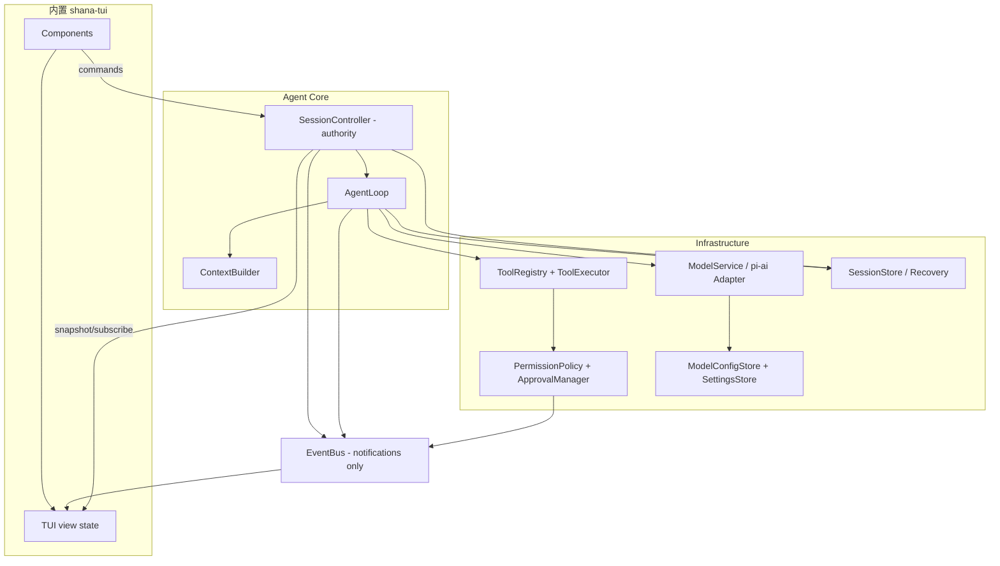

# ShanaAgent — 架构设计

> 整体架构基线：系统约束、模块责任、控制流程与已确认设计决策。**行为细节（Schema、数值默认、文案、展示交互）以代码实现为唯一依据**；工具边界摘要见 Tool.md。
> 技术栈：TypeScript · Node.js >=22.19.0 · 内置 shana-tui · `@earendil-works/pi-ai`（固定 1.5.2）；主要面向 DeepSeek Flash / Qwen Flash，单 Agent、仅 TUI。

## 1. 目标、边界与不变量

目标：① 单进程单活动 Run，独占维护操作（手动压缩）不与 Run 重叠；② 多进程可共用工作区，无工作区锁、无跨进程调度、不承诺写文件事务隔离；③ TUI 与 Core 分离，仅经 Controller 命令、只读快照与事件通知交互；④ 直接 `await` 调用链，EventBus 只发通知，正式状态不依赖 UI 重建；⑤ 面向 Flash 模型的稳定多轮工具调用；⑥ 可审计可恢复：完整审计历史、Context 只选完整或受控 Turn、关键记录在副作用前后提交、不自动重放结果未知的工具；⑦ 首发 Windows 与 Linux/WSL，无法同步验收时 Windows 优先。

非目标：Web/RPC/远程 UI；Subagent/多 Agent/插件/动态扩展；工作区锁与跨进程协同；沙箱隔离恶意代码（定位为**可信开发环境中的误操作防护**）；Session 分支树、历史回退执行、凭据保险库；函数级 Scope Policy。无辅助决策模型：审批由本地三模式策略与保守 bash analyzer 判定，判不了转人工。

| 编号 | 不变量                                                                                                                    |
| ---- | ------------------------------------------------------------------------------------------------------------------------- |
| I1   | Controller 同步取得 Run 执行权（第一个 `await` 之前），拒绝并发提交；不存在 Prompt FIFO 队列。                            |
| I2   | 运行中允许草稿、取消、审批及调整后续 Run 思考强度（当前快照不变）；不可提交 Prompt、切换 Session/模型或执行其他普通命令。 |
| I3   | Run 结束前工具执行/终止与关键日志收尾必须得到明确结果；一个 Run 只产生一次终止事件。                                      |
| I4   | 工具意图记录成功持久化后才可开始执行；正式完成事件不得早于相应成功持久化。                                                |
| I5   | Session History 永久保留完整审计（唯一例外：aborted partial 的半截 thinking 在落盘前剥离，经用户授权修订）；LLM Context 含可用的完整 Turn、受控的用户中断 Turn（aborted，显式标注）与未知/缺结果 Turn（显式 unknown 占位 + 询问标注）；用户 Prompt 恒进 Context（零 Turn 失败 Run 附失败标注；零 Turn 取消 Run 不附标注，其下一条 Prompt 渲染期前置中断前缀，不落盘，经用户裁决修订）。 |
| I6   | 缺结果/未知结果的工具可在构建上下文时合成显式 unknown 占位（仅渲染期、不落盘、绝不写成确定态），使 Turn 受控进入上下文并附"停下询问用户"标注；恢复不自动重放工具；门控不变。 |
| I7   | 权限以实际 Tool Call 为对象；readonly/auto 模式下文件工具区外写入必须逐次人工审批（模型与会话授权均不能豁免）；full 为用户显式全豁免（含区外写入与 skills 写入），路径复验与内容规则仍强制（§5，经用户授权修订）。 |
| I8   | `/resume` 原子抢独占锁后续写原历史，不复制不新建身份；同一 Session 同时仅一个持锁写者；异常残锁仅人工确认处理。           |
| I9   | 模型切换只影响后续 Run；跨模型继续必须重新计算上下文预算。                                                                |

## 2. 模块与职责

三层位于同一 Node.js 进程。依赖方向从 Controller/AgentLoop 指向基础设施；允许合并小文件，不破坏边界、不做空泛抽象。



- `SessionController`：活动 Session/Run/独占操作与状态转换的唯一权威；命令入口 + 快照/订阅。
- `AgentLoop`：顺序驱动 Turn（流式 LLM → 完整响应 → 工具批次 → 下一 Turn），不拥有状态机。
- `EventBus`：进程内有序通知，监听异常隔离，高频可合并；不做可靠队列、不隐式执行。
- `ContextBuilder`：组装提示词、项目指令、有效完整 Turn、压缩检查点与模型预算。
- `ModelService`/Adapter：pi-ai 对接、流式、重试与停止原因标准化；不做工具循环。
- `ToolRegistry`/`ToolExecutor`：六工具静态注册 + `view_image` 条件注册；校验、路径策略、权限、执行、裁剪、结果标准化。
- `PermissionPolicy`/`ApprovalManager`：allow/ask 判定与异步审批（允许一次/本会话/拒绝）。
- `SessionStore`/Recovery：生命周期、持久化、独占锁、续写、校验、压缩检查点；唯一历史数据源。
- `ModelConfigStore`/`SettingsStore`：配置读取校验与原子写回，不静默修复损坏配置。
- TUI：交互与展示；不直接调用 LLM、不用 Token Delta 组装权威消息。

## 3. Controller 状态与事件

- 命令：Prompt 仅空闲可提交（Core 层再校验 Busy）；运行中可草稿/取消/审批/调整后续 Run 强度；`/model` `/new` `/resume` `/compact` `/exit` `/mode` 在空闲或其允许生命周期内处理；`/compact` 是独占维护操作；Run 结束后草稿保留、**绝不自动提交**。
- 状态：`idle / running(phase) / compacting`；phase ∈ preparing/streaming/compacting/executing_tool/awaiting_approval/cancelling/finalizing；outcome ∈ completed/cancelled/failed/turn_limit。Controller 唯一改变状态；Run 计时用单调时钟。
- 取消截止点：开始提交终止记录前取消有效；开始提交时冻结最终结果，此后取消不改结果。即使终止持久化失败，也在内存终结并发布 `failed`（注明未持久化）；`run.finished` 恰一次。取消不丢弃已完整生成的响应（照常落盘进 Context），仅阻止后续工具执行；流式中途取消把已生成部分落盘为 aborted Turn（§6）；已开始的 write/edit 写入临界区完成并如实报告。
- 事件三类：Command（有返回/异常）、正式生命周期 Event、流式展示 Event（可合并跳过）。一致性快照 + 订阅同一操作提供；快照轻量不含全量历史，历史由 TUI 按需经 Controller 读取已提交记录。审批摘要对 write/edit 携带**完整调用参数**供 Diff 预览，载体不截断（折叠仅展示层）。流式事件含 `tool.output.delta`（bash 运行中输出尾快照，~1Hz、整体替换语义、直发不合并）：仅展示，不入快照/Context/JSONL，取消即清除。

## 4. AgentLoop 与 LLM 请求

- Run 路径：提交 → 同步预留 → 模型/settings 快照 → 初始化或追加 Session（初始记录 fsync 后才发布身份）→ ContextBuilder → 流式请求 → 完整 Assistant 消息持久化 → 工具逐个「校验 → 权限 → 执行 → 结果持久化」→ 下一 Turn → 统一收尾。
- Turn = 一次逻辑 LLM 响应及其完整工具批次；同批顺序执行，单项被拒不阻断其余；重试不计 Turn；`maxTurns` 命中时最后完整批次照常执行后以 `turn_limit` 收尾。工具普通错误不自动导致 Run 失败。
- 重试：可重试错误有限次指数退避（每 Turn 单独计算）；SDK 客户端自带重试必须关闭或受控；错误分类依赖 pi-ai 字符串启发式，不假设稳定错误码。失败尝试片段仅临时展示、不拼接、不入 Context。
- 执行与回放门控：流式片段只供展示；`stopReason=length` 整批不执行，为可配对调用返回未执行结果；仅整条消息可合法回放且所有调用闭合才进下一 Turn。参数解析与有限修复白名单见代码（`src/llm/argument-parser.ts`）。
- 溢出：Context Length Exceeded 不可重试；每 Run 至多一次自动压缩补救并在同一 Turn 重发，失败则 Run failed 并建议 `/compact`；补救必须 TUI 可见，不得静默。
- 跨模型继续：保证**可见上下文连续**，不保证思考连续（pi-ai 按设计丢弃其他模型 thinking 块）；适配失败明确报错，不静默丢可见历史。

## 5. 工具系统与权限

六工具固定：`read`（按行读取裁剪）、`glob`（路径搜索）、`grep`（内容搜索）、`write`（新建/覆盖）、`edit`（精确替换）、`bash`（Windows → Git Bash，Linux/WSL → 系统 bash）；另 `view_image`（只读看图）条件启用——model.json `input` 含 `image` 时注册为第七工具，否则工具集中不存在（调用报 Unknown tool）。边界摘要见 Tool.md，完整行为以代码为准。glob/grep 递归不跟随符号链接，实现分别为 globby 与 @vscode/ripgrep（缺失明确报错，不静默降级）。

- **UTF-8 ground rule**：read/write/edit 只操作 UTF-8 文本；解码失败即判二进制并拒绝，不降级、不静默跳过、不覆盖；同为 priorContent 快照的二进制判据。carve-out：仅 read/write/edit 受此约束，`view_image` 是显式二进制只读通道（扩展名白名单 + magic 校验、仅成功带图，见 Tool.md）。
- 模型可见错误以 `Error:` 开头；Session 只存实际发给模型的格式化裁剪后 ToolResult（priorContent 例外，见 §6）。edit 不做版本快照比对，TOCTOU/丢失更新不在首发强一致性承诺内。
- 审批模式（每 Session 持久化于 meta，缺省 `auto`；Run 起点冻结，运行中切换只影响后续 Run；`/mode` 查询/切换）：

| 操作                | readonly               | auto                                   | full        |
| ------------------- | ---------------------- | -------------------------------------- | ----------- |
| 区内 read/glob/grep | 允许 `workspace_read`  | 同左                                   | 同左        |
| skills 只读（read/glob/grep/view_image） | 允许 `skills_read` | 同左              | 同左        |
| 区外 read/glob/grep | 逐次人工（无授权键）   | 逐次人工（无授权键）                   | 允许 `mode_full` |
| 区内 write/edit     | **策略拒绝**           | 允许 `workspace_write`（无审批无授权） | 允许 `mode_full` |
| 区外 write/edit（含 skills） | **策略拒绝**    | 逐次人工，授权不能豁免                 | 允许 `mode_full` |
| bash                | **策略拒绝**（即使只读命令） | 会话授权命中 → `session_grant`；否则本地 analyzer 放行 → `bash_policy`；否则逐次人工（可"本会话允许"） | 允许 `mode_full` |
| 未知工具            | registry 层 `Unknown tool`（不到门控） | 同左                    | 同左        |

- readonly 的拒绝判据是动态真实调用对象（`action.type !== "read"`）；策略拒绝文案 `Denied by read-only mode.`，与用户逐次拒绝（`User denied.`）严格区分。full 放行的是**审批**，不是安全校验：路径复验、UTF-8/NUL、参数严格校验、限额、取消边界全部保留。
- 门控顺序：executor 默认允许（区内/skills 读跳过门控，与模式无关）→ unknown 防御（任何模式人工）→ full 放行 → readonly 非读策略拒绝 → read 分支（区外人工）→ auto 区内写放行 → bash 会话授权 → auto bash analyzer → 人工。`~/.shana/skills` 是只读豁免区：read/glob/grep/view_image 恒允许、不需审批（根 realpath 规范化，symlink 逃逸不豁免）；write/edit/bash 不豁免，skills 写入在 readonly/auto 属区外逐次人工审批且会话授权不能豁免（full 例外，D1）。区外写入由代码按真实路径强制人工。
- bash analyzer（`src/security/bash-policy.ts`，纯函数零 IO，经 `BashCommandAnalyzer` 函数类型 seam 注入 ApprovalManager）：v1 为首命令白名单（`ls pwd echo cat head tail wc which whoami hostname uname true false`）+ 元字符/赋值前缀/路径守卫（绝对路径、`~`、`..` 上跳、盘符/UNC 一律人工），glob 参数放行；判不了或抛错 → 人工，永不兜底放行。**已声明残余风险**：区内 symlink 指向区外可被 `cat` 跟随读取（bash 无 path-policy 复验），glob 展开可能命中此类 symlink；analyzer 是 best-effort 第一道闸，auto 为用户显式选择，后续以解析包增强。白名单命令读区内文件与 read 工具既有暴露面等价，无新增。
- 会话授权仅剩 bash 精确命令字符串（文件工具授权已删除，D10）；审批后及关键操作前路径复验；目标变化返回错误不自动重试；复验与操作间的竞态窗口不承诺抵御。会话授权不持久化，仅同一内存持有者连续占用期间有效；外部写入为一次综合审批。
- Diff 预览与历史回看是**纯 TUI 展示层**：不新增事件；预览旧内容按需读盘（预览≠执行时刻），历史回看用持久化参数 + priorContent 重建、不读盘；模型可见 ToolResult 不含 Diff。
- Shell 边界：每调用独立子进程（cwd 固定工作区根）；超时混合收尾——确认终止 → 确定超时结果、Run 继续，无法确认 → 副作用未知收尾并阻塞下个 Run 至知情确认。取消/退出终止进程树并等待收尾，未确认如实提示可能遗留进程；不回滚副作用；结果未知按 §6 门控。取消且确认终止的 bash 返回确定态结果，文案提示命令可能已部分执行、需先核实副作用（不触发门控）；无法确认终止仍按 unknown 门控。运行中 TUI 以 ≤1Hz 尾快照展示实时输出，仅展示层，最终裁剪结果不变。

## 6. Session：创建、恢复、保存

```text
~/.shana/
├── model.json / settings.json
├── logs/                          # 诊断日志，与 Session 审计物理分离，永不包含 API Key
├── skills/<skill-name>/SKILL.md   # 显式调用的 skill（只读豁免区，§5）
└── sessions/<workspace-id>/<session-id>/
    ├── meta.json / messages.jsonl / context-checkpoint.json
    └── <session-id>.session.lock  # 写者占用标记
```

- `workspace-id` = 规范化路径末段 slug + sha256 短哈希，多进程推导一致；是历史组织标识，不是锁。产品名 ShanaAgent，CLI 名 `shana`，数据目录 `~/.shana/`。
- Session v6：meta 与首条记录均 `version: 6`；未知版本拒载、不迁移、不降级（v2–v5 Session 不再可读，文件保留不删除；列表跳过不可读版本）。meta 可选 `approvalMode`（readonly/auto/full，缺省 auto）。首次正式提交 Prompt 才创建 Session；草稿/调整/连续 /new 不创建目录。
- 独占占用锁：原子独占创建抢锁，整个占用期持有；`/resume` 抢锁后**续写原 Session**（不复制、不改身份、前缀不改写），recordSeq 从真实尾部重建；残锁仅人工确认移除，不自动删锁/偷锁；尾部截断可只读展示但拒绝续写。
- History 与 Context 分离：History 永久完整审计（含失败/取消 Run 原始 Prompt 与 aborted 响应原文；唯一例外：aborted partial 的半截 thinking 在落盘前剥离——推理草稿无续写价值，回传可能误导模型与压缩摘要，经用户授权修订，连带丢失"模型曾试图发起半截 call"的纯思考痕迹）；Context 以完整或受控 Turn 为最小单位——用户 Prompt 恒进 Context（零 Turn 失败 Run 附失败标注；零 Turn 取消 Run 不附标注，纯思考取消剥离后无实质内容即走此路径，其下一条 Prompt 渲染期前置 `[The previous request was interrupted before completion.]` + 换行——前缀是记录的确定性函数、仅渲染期注入不落盘，`user_prompt` 记录恒存用户原文，正式请求/压缩摘要输入/锚定重建同源，经用户裁决修订）；用户中断的 aborted Turn 在可配对 call 均有确定结果时进入 Context 并附中断标注，半截 call（id/name 缺失或重复）构建上下文时剥离、History 留原文；旧记录中已落盘的 aborted thinking 构建上下文时剥离（读取兜底）、TUI 同构不显示；unknown 结果或缺结果（崩溃窗口）的 Turn 受控进入 Context：缺结果在渲染期合成显式 unknown 占位（不落盘、绝不写成确定态，文案明说"是否执行过未知"），Turn 末附询问标注（不重试、不假设成败、先请用户核实）；协议损坏 Turn（非法 call 身份、错配/多余结果）仍排除。
- 七类记录：`user_prompt / run_started / assistant_message / tool_result / interruption / run_finished / checkpoint`；`user_prompt` 可选 `skill` 快照（name/location/content，提交时冻结；`text` 恒存含 `/skill:` 命令的完整原文，快照正文剥 frontmatter 后 trim）；tool_result 状态 success/error/denied/timeout/not_executed/unknown（前五确定）；以 `assistantRecordSeq + toolCallId` 配对。tool_result 可选 `images` 块（仅 view_image 成功携带：恰 1 项，base64 数据 + mimeType + 宽高，记录级严格校验）。工具调用存产品自有类型：`rawArguments` 原文不修复不脱敏 + `parse` 结果（parsed/invalid 分类）。
- Turn 上下文完整判据（回放/恢复/压缩共用）：响应已结束（stop/toolUse/length/aborted）且可合法回放；工具调用 ID 非空、同轮唯一、名称完整；每个 call 有唯一配对的已提交结果（任意 status，含 unknown）或无结果（崩溃窗口，构建时合成 unknown 占位）；错配/多余结果属协议损坏，判不完整；aborted 仅校验可配对 call（半截 call 剥离后不参与）；参数错误不使 Turn 不完整；截断普通文本不完整；length 例外见 §4。门控仍按记录判定（缺结果/unknown 均列出），不受此判据影响。
- 关键提交：意图 fsync 后才执行工具；结果 fsync 后才宣布完成；写入 + fsync 是不可被取消中断的临界区；意图提交失败不执行未开始工具；结果提交失败停 Run 不重跑。
- **priorContent 不变量**：write/edit 成功写入必带写入前全量快照（新建文件为空串）；捕获失败（ENOENT 之外）不写入；仅供 TUI 历史 Diff，不入 Context；存储恒全量，折叠仅展示层。
- 恢复门控：缺确定结果/副作用未知须知情确认（仅确认知晓，不臆断成败）；记录保持 unknown 不改写；不自动重放、不继承旧授权、不重连旧 Shell 句柄。unknown 占位仅是渲染期上下文归一化，不落盘，门控判定仍基于记录。日志与文件系统副作用不构成原子事务，恢复提供可解释执行事实。

## 7. ContextBuilder、指令与压缩

```text
System Prompt (<agent> + <core_rules>) + <environment> + <project_instructions>
+ 有效上下文（checkpoint 摘要 + eligible Turn，含受控 unknown/缺结果 Turn）+ 当前 User Prompt + 工具 Schema
```

- 提示词存 `prompts/` 独立英文文件，区块用英文 XML 标签；工具 description 在 `prompts/tools/`、Schema 在 `src/tools/registry.ts`、Error 模板在工具代码。只读工作区**根** AGENTS.md，每 Session 冻结快照；读取失败 Run 继续、省略区块、不向模型注入失败事实。
- Skill 显式调用（`/skill:<name> [请求]`）：Run 开始前同步加载 `SKILL.md` 快照，失败抛面向用户的错误、不创建 Session/Run/事件；模型侧渲染为 `<skill name location>` + 引导语（`prompts/skill-invocation.md`）+ 快照正文 + `</skill>` + 空行 + 请求原文（空请求允许），中断前缀叠加在最前；正式请求、压缩摘要输入与锚定重建共用同一渲染内核（`renderPromptText`），逐字同构；压缩摘要保留执行中 skill 的指令要点（`prompts/compaction.md`）。System Prompt 零改动。
- Checkpoint 摘要以 `<conversation_summary>` **头部 user 消息**注入，不落盘、不计 Turn、属低信任历史数据，不得改变权限或指令。
- 请求可行性：`E + CONTEXT_SAFETY_MARGIN_TOKENS <= C`（余量为代码命名常量，不进 settings）；`maxTokens` 不作输出预留参与判定。Token 估算为近似（ASCII 4 字符/token、非 ASCII 1.5）；image 块按 `ceil(width×height/750)` 计费、钳位 [256, 16384]，头部解析失败回退 4096。上下文按当前模型能力双模态渲染：`input` 含 `image` 时 tool_result 的 images 重建为 image 块，否则渲染期替换为显式占位文本（记录永久保留、切回视觉模型可逆，占位不报不兼容）。
- 阈值与可行性判定的 token 数优先**usage 锚定**：最近一次可信实测 prompt（`usage.input + cacheRead + cacheWrite`）+ 未测量增量的估算。Run 起点锚定须校验：实测前缀与当前重建上下文逐条一致（忽略 timestamp）、模型身份一致、工具 Schema 未变（经 run_started 的 settings 快照与 `input` 能力快照重建比对，视觉↔文本切换致工具集变化时回退）；usage 缺失/全零占位、换模型、校验不符或压后重建时回退纯估算。压缩内部相对预算（Turn 分解、裁剪阶梯、压后收口）保持纯估算自洽。已知有界残差：System Prompt/environment 不落盘，跨进程版本变更的头部漂移不可校验；旧记录 aborted thinking 读取剥离后，历史实测含当时发送的 thinking，锚定偏高、误差以被剥 thinking 大小为界、方向安全（提前压缩），下一次响应重新锚定即消除。
- 压缩只在完整稳定 Turn 边界；自动触发点 **(A)** 首次请求前、**(B)** 完整 Turn 结束后下一请求前，条件 `E >= C × 阈值`；Run 结束不检查；覆盖边界必须前进；已结束的零 Turn Run 也可提供新边界；一次失败后该 Run 不再自动触发。
- 保留策略：(A) 覆盖当前 Run 的 Prompt 前截至最近合法边界的有效历史；崩溃留下的无 Turn、无 run_finished 的尾部 Prompt 保留至后续合法边界；(B) 优先保留当前有效 Run，超出尾部预算时保留其完整 Prompt 和最近连续 Turn，至少尝试保留最新完整 Turn。手动 /compact 对最近有可回放 Turn 的 Run 使用同一预算，并保留其后的 Prompt；若仅有该 Run 可压，允许覆盖早期 Turn。溢出补救优先推进覆盖边界。
- 请求形态：主路径复用有效上下文开头至覆盖边界的消息 + 压缩指令（`prompts/compaction.md`），System Prompt 与工具 Schema 原样保留命中前缀缓存；装不下回退为阶梯裁剪 toolResult 文本（保头保尾，每档同时将 image 块替换为丢图占位），Prompt/可见文本/调用参数永不裁剪，回退不附工具 Schema。摘要输入的预算与渲染同当前模型能力同构。手动 `/compact` 可携带用户附加重点（`/compact <重点>`），追加在指令模板末尾的 `Additional focus` 段；focus 只进本次摘要请求，不入库、不写 checkpoint、不参与 `promptVersion`（与压缩指令不落盘同一口径），其 token 计入指令预算。
- 检查点 = 摘要 + `coveredUpTo(recordSeq)` + 摘要请求自身的实测 `usage`（`input/cacheRead/output/durationMs`，durationMs 缺省表示 Provider 未报告耗时）；尾部按 `recordSeq > coveredUpTo` 判定，跨边界保留的 Turn 按 runId 从完整 History 补回其 Prompt；已结束且无可回放 Turn 的 Run 可用 run_finished 作边界；原始历史不变。纯缺结果 Turn（所有 call 均无结果记录）可以其 assistant_message 作边界——Run 已死且不重放，结果永不再现；已有任一结果的 Turn 边界仍须落在最后一条 tool_result。落在覆盖范围内的零 Turn Run Prompt 同样进摘要输入，不被静默丢掉；摘要必须保留未解决的 unknown 副作用事实。压缩由当前默认模型执行、不计 Turn、独立重试次数；摘要输出无硬上限（no-force），软目标 + 压后可行性收口；失败保留原 Context 并报错，不注入 Context。状态栏的 Cache/Speed 是整段对话的累计口径（全部已计入 Run 的 assistant + 所有 checkpoint 的摘要请求，跨 Run、跨压缩持续累加，**压缩不重置**）：Cache = `ΣcacheRead / (Σinput + ΣcacheRead)`，Speed = `Σoutput / ΣdurationMs`；摘要请求是真实请求，其用量随 checkpoint 落盘，重启 / `/resume` 后累计完整；摘要请求耗时缺省时只计 token、不计速度。Context 是 Core 维护的单一权威值，经快照暴露、状态栏直显（展示层不自读 usage 选值）：优先"最近一次可信实测 prompt（`input+cacheRead+cacheWrite`，全零占位拒信为未计数）+ 未测量增量估算"，无可信锚点时全量估算（含系统提示词、工具 Schema 与全部消息）并加 `~` 前缀；未知（重建失败、model.json 非法）显 `—`。每 Turn、Run 收尾（含取消）、压缩、`/new`、`/resume`、启动同步维护；压后落入纯估算，新实测落盘后重新锚定。

## 8. 配置与模型管理

- `model.json`：自有格式，解析映射为 pi-ai Model；`api` 固定 openai-completions；`/model` 只列用户配置模型。凭据**仅明文 apiKey**，不支持 `$VAR`、不用 pi-ai 凭据链；TUI 掩码、日志与错误脱敏（Provider 回显可能含 Key 片段，须二次脱敏）；工具调用参数例外保留原文。`contextWindow`/`maxTokens` 必填，前者可有意低于官方上限、按配置生效。`compat` 不依赖 pi-ai 自动探测，`supportsDeveloperRole` 默认 false、`requiresToolsWithToolHistory` 默认 true（pi-ai 1.5.1 起无工具请求默认省略 tools 字段，此默认值维持压缩摘要请求发送 `tools: []` 的原有前缀）、显式配置优先。第一版不做费用记账。无有效模型可启动但禁提交；`/model` 与强度调整原子写回、只影响后续 Run；每 Run 固定模型快照。
- `settings.json`：无 version，严格 Schema 拒损坏、不静默修复；数值参数 = 可配置项 + 代码命名常量，默认值与范围以代码（`src/llm/settings-store.ts`）为准；启动加载、重启生效；写入临时文件 + 原子替换，多进程不加锁。`decisionTimeoutMs` 已随决策模型移除：旧 settings 含该键将报"未知字段"启动失败，删除该键即完成迁移。

## 9. 内置 shana-tui TUI

- 框架优先：内置 shana-tui 位于 `src/tui/framework/`（来源与许可见同目录 SOURCE.md）。
- 交互不变量：TUI 不是唯一安全门，Controller 仍校验状态/权限；审批为非遮挡面板、键盘焦点归审批；快照 + 订阅原子提供；高频流式聚合渲染，TUI 慢不影响 Core 推进；展示层不改写存储、SDK 消息与模型回放；TUI 意外退出请求取消并收尾，不让 Agent 无人管理继续执行。
- 布局、键位、配色、折叠、鼠标等展示交互细节以代码（`src/tui/`）为准。状态栏显示当前审批模式（`Mode: readonly|auto|full`，full 以警示色提醒全豁免）。
- Skill 调用展示：蓝色 skill 卡片（标题 `skill:<name>`，默认折叠、点击展开快照 Markdown 正文）置于请求气泡之前；气泡只显示请求原文（空请求不渲染气泡）；`/` 与 `/skill:` 补全菜单均按需读 skills 目录、无缓存，`/` 菜单命令在前、`/skill:<name>` 项按前缀匹配追加在后（无占位项，`/skill:` 语法提示保留在未知命令提示中）。

## 10. 工程目录

```text
├── package.json / tsconfig.json / build-assets.mjs
├── prompts/                      # 系统与专用提示词（英文，每词一个文件）+ tools/ 工具描述
├── src/
│   ├── main.ts / bootstrap.ts / workspace.ts / diagnostics.ts
│   ├── core/                     # session-controller / agent-loop / context-builder / event-bus / events / state / skills
│   ├── llm/                      # model-service / provider-adapter / model-config-store / settings-store
│   │                             # argument-parser / history-replay
│   ├── tools/                    # registry / executor / prompts / read / glob / grep / write / edit / shell
│   │                             # view-image / image-header
│   ├── security/                 # permissions / approval-manager / bash-policy / path-policy
│   ├── sessions/                 # session-store / records / recovery / compaction-store
│   └── tui/                      # app / store / theme / approval-preview / syntax-highlight
│       ├── framework/            # 内置 shana-tui、native 与许可
│       └── components/           # Conversation / AssistantMessage / UserMessage / SystemMessage / SkillMessage
│                                 # ToolExecution / ToolRenderers / ApprovalDialog / DiffView / StatusBar / BottomSelector
└── tests/                        # 镜像 src/：core / llm / tools / security / sessions / tui / integration
```

不设 PromptQueue、WorkspaceLock、SessionBranchTree、PluginManager、RPC Server 或跨进程协调目录。

## 11. 已确认设计决策（不得反向推翻）

> 以下均经用户确认；反转、变通或修改必须经用户同意。细节以对应章节与代码为准。

- 单 Agent、单进程单活动 Run；多进程共用工作区不加锁，同一 Session 仅一个写者 → §1、§6
- 运行中不收新 Prompt、无 Prompt 队列；草稿/取消/审批可用 → I1/I2、§3
- /resume 持锁续写 + 残锁人工确认；不继承旧内存授权、不自动续跑 → I8、§6
- 三模式审批门控（readonly/auto/full）与 bash 本地保守 analyzer（判不了转人工，永不兜底放行）→ §5
- Diff 两项独立决议：预览/历史回看纯展示层；模型可见结果不含 Diff → §3、§5、§6
- 六工具固定 + `view_image` 条件启用（model.json `input` 含 `image` 时注册，否则不存在）；write 可覆盖；edit 精确匹配 + replace_all + 多重匹配报数量 → §5、Tool.md
- UTF-8 ground rule（view_image 为显式二进制只读 carve-out）→ §5
- 用户 Prompt 恒进 Context（零 Turn 失败 Run 附标注；零 Turn 取消 Run 的下一条 Prompt 渲染期前置中断前缀，不落盘，经用户裁决修订）；aborted Turn 受控进入并标注；unknown/缺结果 Turn 受控进入（渲染期显式 unknown 占位 + 询问标注），门控不变；协议损坏 Turn 排除 → §6
- 意图先于执行、结果先于完成、fsync 临界区不可中断 → I4、§6
- Session v6 七类记录与判据不由实现擅改（user_prompt 可选 skill 快照；tool_result 可选 images 块，仅成功单图；checkpoint 可选 usage = 摘要请求实测用量；v2–v5 硬切不迁移，经用户授权）；workspace-id 多进程一致 → §6
- Skill 显式调用 `/skill:`：提交时快照、text 恒存完整原文；加载失败 Run 前同步报错不创建 Session；skills 只读豁免精确限 `~/.shana/skills`（read/glob/grep/view_image），写入不豁免；TUI skill 块默认折叠、气泡只含请求原文；标题/预览剥命令前缀（空请求回退 `skill:<name>`）→ §5、§6、§7、§9
- Shell 超时混合收尾与知情确认 → §5、§6
- 溢出不可重试 + 每 Run 一次压缩补救 → §4
- 压缩 A/B 触发、最新 Turn 保留、主路径/回退裁剪、摘要头部 user 消息 → §7
- 配置：仅明文 apiKey、compat 不依赖自动探测、无费用记账、严格 Schema → §8
- 跨模型保证可见上下文连续；错误分类依赖字符串启发式；SDK 重试受控 → §4
- Controller 唯一状态权威、SessionStore 唯一历史源、EventBus 只通知 → §2、§3
- 诊断日志独立脱敏；Session 权限尽力而为 → §6
- 提示词与 Error 模板英文、prompts/ 独立文件；只读根 AGENTS.md → §7
- 首发 Windows、Linux/WSL → §1
- 审批模式轮决策（D1–D13，均经用户确认）：D1 I7 修订——full 为显式全豁免（含 skills 写入），路径复验/内容规则各模式不变；D2 策略拒绝 `denied_by_policy` + 最短文案 `Denied by read-only mode.`（不复用 User denied.）；D3 无决策模型，bash v1 首命令白名单 analyzer，`BashCommandAnalyzer` 函数类型 seam 注入；D4 决策模型子系统整体删除（用户 decision-model.json 文件保留不动）；D5 Session v6 硬切拒载；D6 模式每 Session 持久化、Run 起点冻结、/mode 无参重载 meta；D7 readonly 区外读逐次人工；D8 缺省 auto；D9 `/mode` 硬切无别名；D10 文件工具会话授权删除（仅留 bash 精确命令授权）；D11 bash 白名单 13 项 + 元字符/路径守卫（细则以 `src/security/bash-policy.ts` 为准）；D12 删除死字段 `RegisteredTool.access`/`ToolAccess`，readonly 判据 keyed on 真实 action；D13 settings 严格未知键拒绝保留（decisionTimeoutMs 迁移提示见 §8 与 CHANGELOG）→ §5、§6、§8
